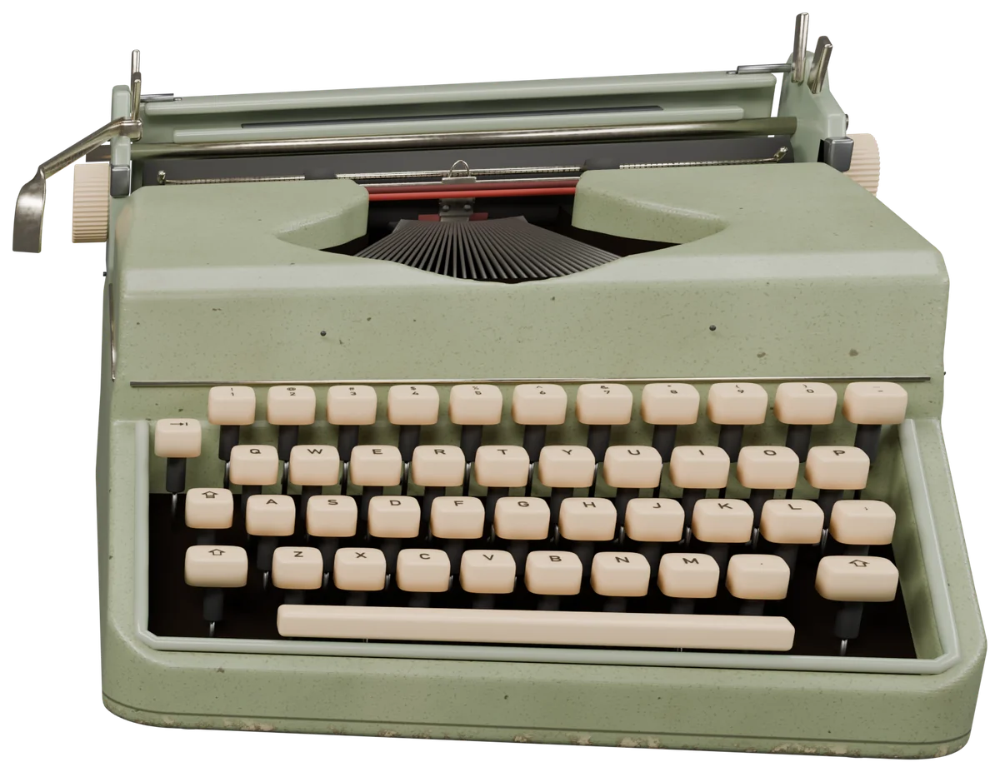

# 桌面打字机 Desk Typewriter

**中文** | [English](README.en.md)

一台住在屏幕角落的老式打字机。敲一张纸条寄出去，它会在朋友的屏幕顶上一行一行打印出来。

支持 Mac 和 Windows，免费下载：**https://typewriter.tomcc.workers.dev**



## 能做什么

- 每个键都真的会按下去，有机械声，回车把纸寄走
- 收到的纸条从屏幕顶上往下打出来
- 身边的朋友走蓝牙或局域网直接送，远方的朋友走服务器中转
- 打字声可以换：老式打字机、钢琴音符、水滴、风铃、木琴、下雨、落叶、篝火

## 目录

| 目录 | 是什么 |
|---|---|
| `app/` | 桌面应用（Electron + three.js），打字机模型、纸条窗口、声音都在这里 |
| `server/` | 远程送纸条的中转服务（Cloudflare Worker + Durable Object） |
| `download/` | 下载宣传页（Cloudflare Worker，中英双语，页面上能直接玩 3D 打字机） |
| `shared/` | 应用和服务器共用的协议类型 |
| `docs/` | 设计文档和开发计划 |

## 自己跑起来

需要 Node.js 20 以上。

```sh
# 桌面应用
cd app && npm install
npm start               # 开发运行
npm run dist:mac        # 打 Mac 安装包
npm run dist:win        # 打 Windows 安装包

# 中转服务（想远程送纸条才需要）
cd server && npm install
npx wrangler deploy     # 部署到你自己的 Cloudflare 账号，再把地址填进应用设置里的「服务器」

# 下载页
cd download
node prepare.mjs        # 把 ../安装包/ 里的安装包切片
node build-web.mjs      # 打包页面里的 3D 打字机
npx wrangler deploy
```

`server/wrangler.toml` 里的 KV 命名空间 id 是原作者账号的，部署前换成你自己建的。

## 创作者

1. **籽菜**（[@zizic04](https://github.com/zizic04)）
2. **Claude**（[Anthropic](https://www.anthropic.com)）
3. **汤姆CC**（[@TomCC-9986](https://github.com/TomCC-9986)）

## 许可

代码和美术资源采用 [CC BY-NC 4.0](https://creativecommons.org/licenses/by-nc/4.0/deed.zh-hans)（署名-非商业性使用）：欢迎二创、改编、分享，请注明出处，**不可用于商业用途**。全文见 [LICENSE](LICENSE)。

下载页用到的字体（思源宋体、EB Garamond、IBM Plex Mono）是 SIL OFL 1.1 开源字体，许可证在 `download/assets/fonts/` 里。

